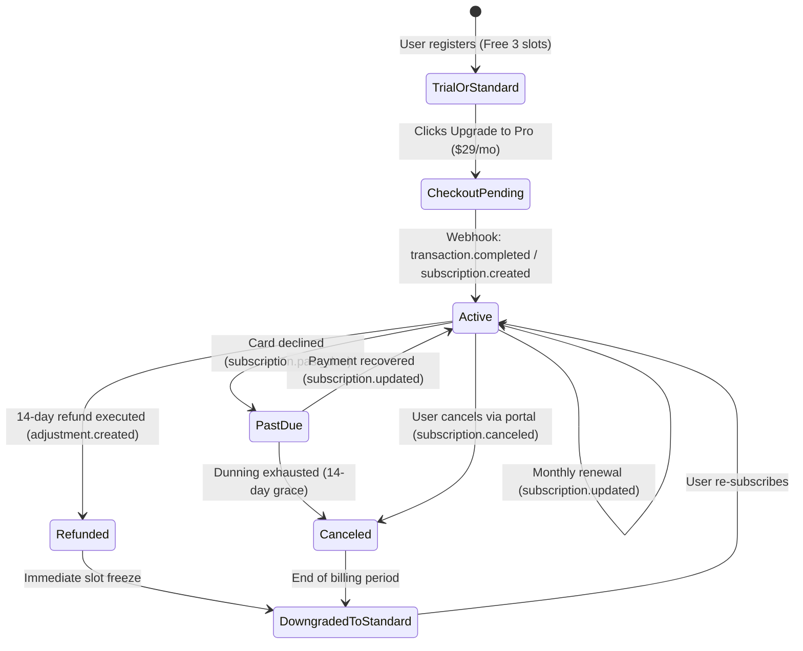

# Billing & Payment Provider Research & Architecture
**Project**: Asmire (asmire.me) — Pro Membership ($29/month Recurring)  
**Entity Location**: Vietnam (Doanh nghiệp Việt Nam có mã số thuế)  
**Target Market**: Global (US, EU, UK, Canada, Australia, Southeast Asia)  
**Date**: 2026-11-21  

---

## 1. Regulatory & Tax Context for a Vietnamese SaaS Business

Selling digital subscription services ($29/mo) to international consumers creates severe compliance hurdles for Vietnamese businesses:

1. **Global Indirect Taxes (VAT, GST, Sales Tax)**:
   - **EU**: Requires VAT MOSS / OSS registration and remittance of varying country rates (17%–27%).
   - **US**: Over 45 states enforce economic nexus rules for SaaS and digital services.
   - **UK**: Requires HMRC VAT registration once thresholds or first sales occur.
2. **Vietnamese Corporate & Invoicing Regulations**:
   - Foreign exchange receipts must flow through an official bank account registered with the State Bank of Vietnam (SBV).
   - Exported services may be eligible for 0% VAT under Vietnamese tax law if specific export documentation (contract, bank transfer confirmation) is maintained, **[NEEDS ACCOUNTANT VERIFICATION]**.
3. **The Critical Advantage of a Merchant of Record (MoR)**:
   - Under an MoR model, the MoR (Paddle or Lemon Squeezy) legally buys the subscription from Asmire and resells it to the end consumer.
   - The MoR is the seller on the customer's credit card statement and files all global sales taxes.
   - Asmire receives a single periodic B2B wire payout from the MoR, dramatically simplifying accounting in Vietnam.

---

## 2. In-Depth Payment Provider Comparison

| Criteria | **Paddle (Billing v2)** ⭐ *Recommended* | **Lemon Squeezy** | **Polar.sh** | **Stripe (Direct)** |
| :--- | :--- | :--- | :--- | :--- |
| **Merchant of Record (MoR)?** | **Yes** (Paddle is the legal merchant) | **Yes** (Acquired by Stripe in 2024) | **Yes** (Acts as MoR) | **No** (Asmire is the merchant of record) |
| **Supports Vietnam Business?** | **Yes** (Supports payout to VN bank via Wire / Payoneer) | **Yes** (Payout via Stripe Connect / Wise / Wire) | **Conditional** (Check supported country list) | **No direct Vietnam support** (Requires Stripe Atlas US/UK setup) |
| **Transaction Fees** | 5% + $0.50 per transaction | 5% + $0.50 per transaction (+1.5% for intl/PayPal) | 4% + 40¢ per transaction | ~2.9% + 30¢ (plus Stripe Tax & Billing fees = ~4.2%) |
| **Global Sales Tax / VAT Filing** | **100% automated & filed by Paddle** | **100% automated & filed by LS** | **Automated by Polar** | Asmire must register and remit in each jurisdiction |
| **14-Day Refund Handling** | Automated via Dashboard, API, or Self-Serve Portal | Automated via API / Portal | Automated via API | Manual or custom API |
| **Chargeback Protection** | Strong fraud detection + dispute representation | Built-in dispute handling | Basic fraud alerts | $15 fee per dispute + merchant loses by default |
| **Customer Portal** | Out-of-the-box hosted portal (cancel, pause, update card) | Out-of-the-box customer portal | Hosted customer portal | Stripe Customer Portal (requires Stripe backend) |
| **Webhook Reliability** | Event-driven, signed HMAC (`Paddle-Signature`), idempotent | Signed webhooks (`X-Signature`), event logs | Fast webhooks | Exceptional webhooks |
| **Payout to Vietnamese Bank** | Monthly / Bi-weekly USD wire directly to VN corporate bank | Payouts to Payoneer / Wise / Bank wire | Payouts via Stripe Connect | N/A (Cannot pay out directly to VN bank) |

---

## 3. Recommended Primary Solution: **Paddle (Billing API v2)**

### Why Paddle is the Superior Choice for Asmire:
1. **Proven Stability & Enterprise Backing**: Paddle has handled B2B and B2C software subscriptions for over a decade.
2. **True MoR Legal Shield**: Protects the Vietnamese founder and company from foreign tax audits in the US and Europe.
3. **Paddle Retain**: Built-in automated dunning emails for failed credit card payments, expired cards, and abandoned renewals, increasing recurring retention by 15–20%.
4. **Native 14-Day Refund Workflow**: Supports instant refunds through the Paddle Billing API (`POST /adjustments`) with automatic prorated tax reversal.

---

## 4. Subscription Lifecycle & Webhook Architecture

### Critical Webhook Events to Handle:
* `subscription.created`: Provision Pro entitlement (`plan = 'PRO'`, `unlimited = true`).
* `subscription.updated`: Update `current_period_end` date, handle plan shifts.
* `subscription.past_due`: Send automated in-app banner and grace period alert (7 days) without immediately terminating member affiliate links.
* `subscription.canceled`: Flag account to revert to Standard at `current_period_end`.
* `subscription.paused`: Downgrade immediately.
* `adjustment.created` (Refund / Chargeback): Immediate downgrade to Standard; freeze member's excess slots (beyond the top 3 most-clicked tools); notify user via email.

---

## 5. Security & Idempotency Rules

1. **HMAC Signature Verification**: Reject any webhook without a valid cryptographic signature (`Paddle-Signature` verification using the webhook secret key).
2. **Database Idempotency**:
   - Every incoming event has a unique `event_id`.
   - Store incoming events in a raw `PaymentEvent` table with a unique constraint on `(provider, event_id)`.
   - If an event ID already exists in `PaymentEvent`, return HTTP 200 immediately without reprocessing.
3. **Out-of-Order Execution Safeguards**:
   - Compare the event timestamp (`occurred_at`) against the database `Subscription.updatedAt`. Discard stale events if an update has already processed a newer event.
4. **Zero Cardholder Data Storage**:
   - Asmire servers NEVER touch, transmit, or store credit card numbers, CVVs, or expiration dates. All payments use Paddle.js embedded overlay or hosted checkout.

---

## 6. Checklist Requiring Legal & Accounting Confirmation

> [!IMPORTANT]
> The following items must be verified by the company's licensed Vietnamese accountant and legal counsel:

- [ ] **[ACCOUNTANT VERIFICATION]** Confirm whether revenue payouts from Paddle to the Vietnamese corporate bank account are classified as "Xuất khẩu dịch vụ phần mềm" (Export of software/digital services) subject to **0% VAT** in Vietnam under Circular 219/2013/TT-BTC.
- [ ] **[ACCOUNTANT VERIFICATION]** Confirm proper documentation requirements for foreign currency inflows from Paddle (contract/terms agreement, monthly payout invoices, bank confirmation advice).
- [ ] **[LEGAL VERIFICATION]** Review `/refund-policy` wording: 14-day unconditional refund policy complies with EU Consumer Rights Directive (Directive 2011/83/EU) while clearly stating that excessive misuse (e.g. creating bot click surges) terminates the account.
- [ ] **[LEGAL VERIFICATION]** Review Terms of Service regarding member indemnification: members are independent contractors responsible for their own tax declarations on affiliate commissions received directly from third-party SaaS vendors.
