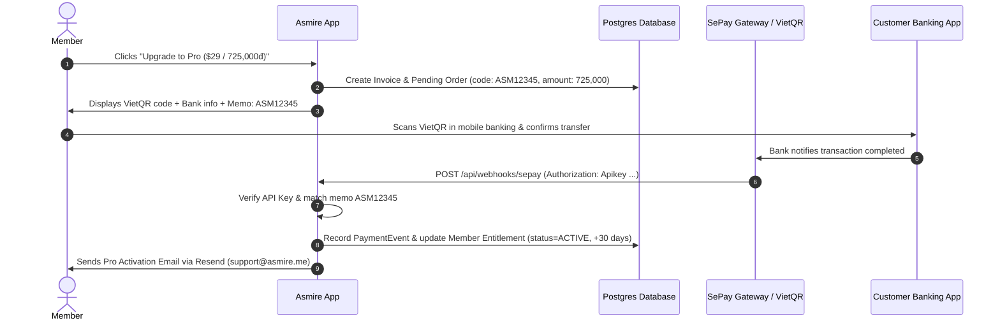

# Billing & Payment Provider Specification: SePay (sepay.vn) Integration
**Project**: Asmire (asmire.me) — Pro Membership ($29/month / 725,000 VND)  
**Payment Gateway**: SePay (Automated Bank Transfer & VietQR API)  
**Entity Location**: Vietnam (Doanh nghiệp Việt Nam có tài khoản ngân hàng chính thức)  
**Last Updated**: 2026-11-21  

---

## 1. Why SePay for Asmire

The website owner confirmed **SePay (sepay.vn)** as the core automated payment gateway:
1. **Direct Payout to Vietnamese Corporate Bank Account**: Payments flow directly from the customer's bank account (Vietcombank, MBBank, Techcombank, ACB, VPBank...) into the company's verified business account. Zero intermediary withholding or freezing risks.
2. **Instant 2–5 Second Automation**: SePay monitors incoming bank transactions and immediately fires a webhook to Asmire upon fund receipt.
3. **VietQR Standard Dynamic QR Codes**: Customers simply open their banking app, scan the dynamic QR code (with pre-filled amount and unique transfer memo), and transfer without typing numbers manually.
4. **Zero Chargeback Risks**: Unlike credit card processors where buyers can initiate fraudulent chargebacks months later, bank transfers in Vietnam are irrevocable push transactions.

---

## 2. Subscription & Prepaid Billing Architecture with SePay

Because Vietnamese retail banking currently does not provide consumer auto-debit APIs without specialized credit cards, SaaS subscriptions with SePay operate under a **30-Day Prepaid Renewable Model**:



---

## 3. SePay Webhook Specification & Security Protocol

### Webhook Endpoint:
`POST /api/webhooks/sepay`

### Security & Authentication:
1. **API Key Authentication**: SePay passes the merchant's configured secret in the HTTP header:
   ```http
   Authorization: Apikey <SEPAY_API_KEY>
   ```
   The Asmire webhook handler MUST verify this token with constant-time string comparison (`crypto.timingSafeEqual`) to prevent timing attacks.
2. **Strict Idempotency**:
   - Check `id` (SePay transaction ID) against the `PaymentEvent` table.
   - If `id` already exists, return HTTP 200 immediately without re-crediting the user.
3. **Memo Parsing & Amount Matching**:
   - Extract pattern `ASM([A-Z0-9]+)` from the `content` field.
   - Verify `amountIn >= requiredPriceVnd`. If an underpayment occurs, log as `UNDERPAID` and notify support.

### Sample Webhook Payload from SePay:
```json
{
  "id": 9876543,
  "gateway": "MBBank",
  "transactionDate": "2026-11-21 18:20:00",
  "accountNumber": "0123456789",
  "subAccount": null,
  "amountIn": 725000,
  "amountOut": 0,
  "accumulated": 15000000,
  "code": null,
  "transactionContent": "ASM9F2K1 thanh toan Pro Asmire",
  "referenceNumber": "FT26325987123",
  "body": "..."
}
```

---

## 4. 14-Day Refund Workflow with SePay

As confirmed by the user, Asmire enforces a transparent **14-day refund policy**:
1. **User Request**: Member submits refund request via `/account/billing` or email `support@asmire.me` within 14 days of initial payment.
2. **Admin Verification**: Admin verifies payment date in dashboard.
3. **Bank Transfer Refund**: Admin executes reverse bank transfer to the customer's account.
4. **Entitlement Reversion**: Order status is updated to `REFUNDED`. System downgrades the user back to the Standard (3-tool) tier and sends a confirmation email.

---

## 5. Checklist for Accounting & Deployment

- [ ] **[ACCOUNTANT VERIFICATION]** Configure SePay to connect to the official corporate bank account of the Vietnamese business entity.
- [ ] **[ACCOUNTANT VERIFICATION]** Set up electronic invoice (Hóa đơn điện tử) integration or monthly revenue aggregation for corporate tax filing.
- [ ] **Configuration via Environment Variables**:
  - `SEPAY_API_KEY`: Secret API token configured in SePay Webhook settings.
  - `SEPAY_ACCOUNT_NUMBER`: Corporate bank account number.
  - `SEPAY_BANK_NAME`: Bank code (e.g. `MBBank`, `Vietcombank`).
  - `PRO_PLAN_PRICE_VND`: Default `725000` (equivalent to $29/mo).
