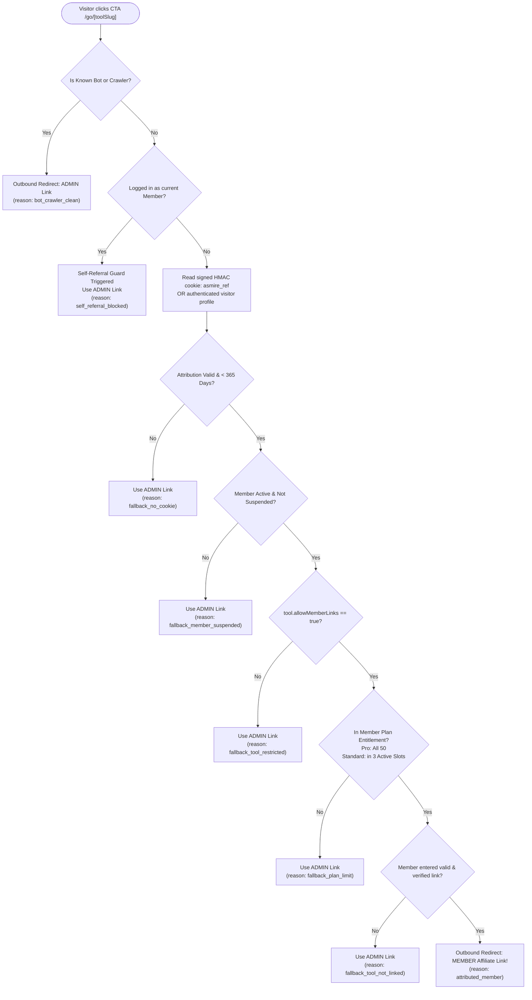

# Member Referral & Attribution Engine Specification
**Project**: Asmire (asmire.me)  
**Document**: Technical & Architectural Specification  
**Status**: Normative / Production Standard  
**Last Updated**: 2026-11-21  

---

## 1. Architectural Overview & Security Invariants

The Asmire Referral Engine enables registered members to share tools and earn direct affiliate commissions from SaaS vendors while leveraging Asmire's domain authority, comprehensive reviews, and SEO ranking power.

### Core Security & Business Invariants:
1. **Zero Client-Side Attribution**: All attribution calculations happen exclusively on the server at the moment of the outbound redirect (`/go/[toolSlug]`).
2. **Deterministic Fallback to Site Owner**: Any tool not linked by the member, or exceeding the member's plan entitlement, deterministically falls back to the Admin (site owner) affiliate link. This is a core commercial principle.
3. **No Phantom Claims**: Asmire records internal site clicks and outbound redirects; it NEVER claims to track vendor-side purchases or actual commission balances unless self-reported by the member with a "Self-reported, unverified" badge.
4. **Cryptographic Integrity**: Attribution cookies are signed with server-side HMAC-SHA256 keys to prevent member ID forging.

---

## 2. The 11 Strict Attribution Execution Branches



### Detailed Branch Specifications:

#### Branch 1: Direct / Organic Traffic (No Valid Referral)
* **Condition**: Visitor lands directly on homepage, category, or review page without referral parameters, and has no valid `asmire_ref` cookie.
* **Routing**: `/go/[toolSlug]` redirects immediately to the **Admin (Owner) Affiliate Link**.
* **Audit Reason Code**: `fallback_no_cookie`.

#### Branch 2: Visitor Arrives via Member Referral (`/r/[code]` or `?ref=[code]`)
* **Trigger**: Visitor hits `https://asmire.me/r/[memberCode]` or any URL with `?ref=[memberCode]`.
* **Action**:
  1. Server looks up `MemberProfile` by `referralCode` where `status = 'ACTIVE'`.
  2. If valid, server sets first-party cookie `asmire_ref` via HTTP response header (`Set-Cookie`).
  3. Clean URL presentation: If visited via `/r/[code]`, server performs internal redirect (HTTP 307) or history replace to the target clean landing page (default: `/en`).
  4. Visitor sees a subtle, non-intrusive disclosure pill: *"You are viewing via a member referral; purchases may credit the member or Asmire."*
  5. Attribution window is established for **365 days (31,536,000 seconds)**.

#### Branch 3: Per-Tool Qualification at Click Time (The Core Commercial Rule)
* **Condition**: Visitor has a valid referral cookie pointing to `Member M`. Visitor clicks CTA for `Tool T`.
* **Server Verification at `/go/[toolSlug]`**:
  1. `Member M.status === 'ACTIVE'` (not suspended, banned, or deleted).
  2. `Tool T.allowMemberLinks === true`.
  3. `Tool T` is within `Member M`'s active plan entitlement:
     - **Pro**: Unconditionally covers all 50 catalog tools.
     - **Standard**: `Tool T` must be explicitly listed in `Member M`'s 3 active slots (`ActiveToolSlot`).
  4. `Member M` has entered a link for `Tool T` with `status === 'VALID'`.
* **Result**:
  - If **ALL** criteria pass: Visitor is redirected to `Member M`'s affiliate URL. (Code: `attributed_member`).
  - If **ANY** criterion fails: Visitor is redirected to **Admin's affiliate URL**. (Codes: `fallback_plan_limit`, `fallback_tool_not_linked`, `fallback_member_suspended`, or `fallback_tool_restricted`).

#### Branch 4: Cookie Expiration or Deletion
* **Condition**: Visitor enters the site after 365 days from the initial touch, or has cleared browser cookies without being an authenticated user.
* **Result**: Cookie is invalid; routing falls back to **Admin Link** (`fallback_no_cookie`).

#### Branch 5: Multi-Referrer Competition (First-Touch Priority)
* **Policy**: **First-Touch Attribution Wins**.
* **Rationale**: Prevents malicious link bombing and social spamming where bad actors try to overwrite legitimate initial referrals.
* **Execution**: If an incoming request contains `?ref=[code_B]`, but the browser already carries a cryptographically valid `asmire_ref` cookie for `Member A` that is still within its 365-day lifespan:
  - The cookie is **NOT** overwritten.
  - The cookie's expiration timer is **NOT** extended.
  - (System includes an admin setting `REFERRAL_ATTRIBUTION_MODEL = 'FIRST_TOUCH' | 'LAST_TOUCH'` to support future business adjustments).

#### Branch 6: Self-Referral Prevention
* **Policy**: A member cannot earn attribution on their own browsing or purchases.
* **Condition**: If an authenticated user browses the site and hits a referral link matching their own `memberId`, or clicks a `/go/` link while logged into their own account:
  - Cookie setting is skipped.
  - `/go/` redirect routes to the **Admin Link**.
  - Audit Reason Code: `self_referral_blocked`.

#### Branch 7: Plan Downgrade, Expiration, or Suspension
* **Condition**: `Member M` was on Pro (50 tools) and referred Visitor V. `Member M` cancels and reverts to Standard (3 tools).
* **Execution**:
  - The visitor's cookie remains intact.
  - For the 3 tools retained by `Member M`, Visitor V's clicks still credit `Member M`.
  - For the remaining 47 tools, Visitor V's clicks automatically fall back to the **Admin Link** (`fallback_plan_limit`).
  - If `Member M` is suspended for fraud, 100% of clicks across all tools immediately fall back to the **Admin Link** (`fallback_member_suspended`).

#### Branch 8: Visitor Account Creation / Newsletter Opt-In Persistence
* **Condition**: While browsing with an active `asmire_ref` cookie, Visitor V creates an account or signs up for the Asmire newsletter.
* **Action**:
  - Server permanently binds `referredByMemberId = Member M.id` and `referredAt = NOW()` to Visitor V's `User` record in the database.
  - Even if Visitor V clears browser cookies, switches to another device, or uses incognito, logging into their account restores the 365-day attribution window server-side.

#### Branch 9: Outbound Audit Logging & Analytics
* Every single `/go/[toolSlug]` request records an immutable row in `ReferralClick`:
  ```typescript
  interface ReferralClickRecord {
    id: string;
    visitorHash: string; // SHA-256(IP + UserAgent + Salt) - non-reversible GDPR compliant
    toolId: string;
    pagePath: string;
    attributedMemberId: string | null;
    isFallback: boolean;
    reasonCode: 
      | 'attributed_member'
      | 'fallback_tool_not_linked'
      | 'fallback_plan_limit'
      | 'fallback_no_cookie'
      | 'fallback_member_suspended'
      | 'fallback_tool_restricted'
      | 'self_referral_blocked';
    targetUrlHost: string;
    createdAt: Date;
  }
  ```

#### Branch 10: Cryptographic Signed HMAC Cookie Structure
* Cookie Name: `asmire_ref`
* Format: `v1.${memberId}.${issuedAt}.${hmacSignature}`
* Generation:
  $$\text{payload} = \text{v1} \mathbin{\Vert} \text{memberId} \mathbin{\Vert} \text{issuedAt}$$
  $$\text{hmacSignature} = \text{HMAC-SHA256}(\text{payload}, \text{ENV.REFERRAL\_SECRET})$$
* Header Settings:
  - `HttpOnly: true` (inaccessible to browser JavaScript)
  - `Secure: true` (transmitted only over HTTPS)
  - `SameSite: Lax` (sent on top-level navigation from external referral links)
  - `Max-Age: 31536000` (exactly 365 days in seconds)
  - `Path: /`

#### Branch 11: Regional Privacy Consent & Bot Exclusion
* **Bot Exclusion**: Known search crawlers and AI bots (Googlebot, Bingbot, GPTBot, PerplexityBot, ClaudeBot) are NEVER assigned referral cookies. They always receive clean canonical pages, and any outbound crawler visits route to the Admin Link with `reasonCode = 'bot_crawler_clean'`.
* **Consent Banner**: In jurisdictions requiring explicit consent for analytical/referral cookies (e.g. EU under ePrivacy/GDPR), cookie creation is withheld until consent is registered. If no consent exists, requests default cleanly to the Admin Link.

---

## 3. Plan Entitlement Matrix & Slot Mechanics

| Plan | Monthly Price | Tool Limit | Slot Switching Rules | Analytics Detail |
| :--- | :--- | :--- | :--- | :--- |
| **Standard** | **$0 / Free** | **3 Tools** | Max 1 slot swap per 30-day rolling window | Total views, total CTA clicks, top tool |
| **Pro** | **$29 / month** | **All 50 Tools** | Unlimited real-time link updates | Tool-by-tool breakdown, referrer URLs, daily time series |

### Standard Slot Swap Logic:
1. Member has chosen tools A, B, C.
2. Member wants to replace tool C with tool D.
3. System checks `lastSlotSwappedAt`:
   - If `lastSlotSwappedAt < (NOW() - 30 days)`: Swap succeeds. Update slot, reset `lastSlotSwappedAt = NOW()`.
   - If `lastSlotSwappedAt >= (NOW() - 30 days)`: Swap rejected with UI message: *"Standard plan allows 1 slot change every 30 days. Next swap available on [Date]. Upgrade to Pro for unlimited tools & instant changes."*

---

## 4. Comprehensive Automated Test Matrix (For Phase 3 Delivery)

The following test suites must pass 100% in CI:

1. `test_branch_1_direct_traffic_routes_to_admin()`
2. `test_branch_2_valid_ref_sets_signed_hmac_cookie_for_365_days()`
3. `test_branch_3a_pro_member_linked_tool_routes_to_member()`
4. `test_branch_3b_standard_member_unselected_tool_falls_back_to_admin()`
5. `test_branch_3c_standard_member_selected_tool_routes_to_member()`
6. `test_branch_4_tampered_or_expired_cookie_falls_back_to_admin()`
7. `test_branch_5_first_touch_not_overwritten_by_second_referrer()`
8. `test_branch_6_self_referral_prevented_when_logged_in()`
9. `test_branch_7_suspended_member_immediately_falls_back_to_admin()`
10. `test_branch_8_authenticated_user_persists_attribution_without_cookie()`
11. `test_branch_9_reason_codes_logged_accurately_in_db()`
12. `test_branch_10_known_crawlers_never_receive_referral_cookies()`
13. `test_security_ssrf_private_ip_rejected()`
14. `test_security_invalid_domain_regex_rejected()`
